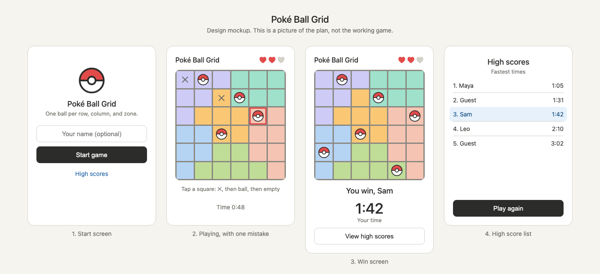

# Poké Ball Grid

A small puzzle game where you place one Poké Ball in every row, column and color zone, and no two balls can touch.

It's inspired by Meow Doku, a cat puzzle game, but with Poké Balls instead of cats. This is a class project, built in about 1.5 hours.

## How to play
- Tap a square to cycle through three states: ✕ (a reminder to yourself), Poké Ball, then empty.
- Put exactly one ball in every row, every column and every color zone.
- Balls can't touch, even diagonally.
- A wrong ball costs one heart and disappears. You have 3 hearts, and the puzzle restarts at 0.
- You win when every row, column and zone has one ball.
- Enter a name (or leave it empty) on the start screen. Your time is saved, and you can see the 5 fastest times.

## Design mockup

This is a picture of the plan, not the working game.

## Status
Planning is done. The game is not built yet.

## More info
See [DESIGN.md](DESIGN.md) for the full design, the build checklist and progress notes.
